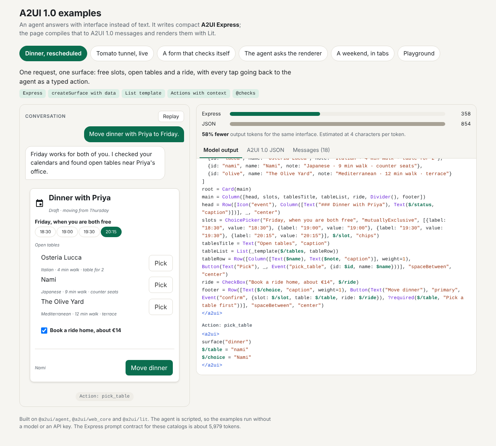

# A2UI 1.0 examples

Six interactive examples of [A2UI 1.0](https://a2ui.org/), the protocol that lets an agent answer
with interface instead of text. Each one shows the conversation, the surface the agent drew, and
what went over the wire to draw it.

The agent writes **A2UI Express**, the compact inference format that shipped with 1.0. The page
compiles it to A2UI 1.0 JSON as it streams in, checks every message against the catalogs, and
renders the result with Lit.



```sh
npm install
npm run dev      # http://localhost:5173
npm test         # compiles every example and replays its actions, without a browser
npm run build    # type-checks and writes dist/
```

Needs Node 22. There is no model and no API key: the agents are scripted, so every run is the same.

## The examples

| Example                     | What it shows                                                                                          |
| --------------------------- | ------------------------------------------------------------------------------------------------------ |
| Dinner, rescheduled         | A whole surface in one `createSurface`, a list template, and actions that carry context to the agent.   |
| Tomato tunnel, live         | Two catalogs on one surface (`@catalogId`), `@index`, and a feed of data-only `updateDataModel`s.      |
| A form that checks itself   | `@checks` with `required`, `email`, `regex` and `length`, and a submit button gated by `and()`.         |
| The agent asks the renderer | `callRendererFunction` and `rendererFunctionResponse`: the agent calls `deviceInfo()` before it draws. |
| A weekend, in tabs          | `Tabs`, `Modal`, `DateTimeInput`, and an `openUrl` action that never leaves the renderer.              |
| Playground                  | An editor: your own Express, compiled, validated and rendered on every keystroke.                      |

## How it fits together

```
scripted agent ──Express text──▶ @a2ui/agent ──A2UI 1.0 messages──▶ @a2ui/web_core ──▶ @a2ui/lit
      ▲                           (compile + check)                  (MessageProcessor)   (<a2ui-surface>)
      └──────────────── action / rendererFunctionResponse ◀──────────────────┘
```

- `src/a2ui/session.ts` is the whole integration: one `MessageProcessor`, one Express stream per
  reply, and the `callRendererFunction` round trip.
- `src/a2ui/greenhouse-catalog.ts` is a custom catalog with two Lit components (`Gauge`,
  `Sparkline`) and one function the agent may call (`deviceInfo`).
- `src/examples/` holds one file per example: the reply a model would write, and how the agent
  answers each action.

To put a real model behind it, give the model `promptContract` from `session.ts` as part of its
system prompt and pass its streamed output to `Session.reply`.

## About the token meter

The meter compares the Express the agent wrote with the JSON it stands for, at four characters per
token. That is a rule of thumb, not a tokenizer. Two things keep it from overstating the saving:
the JSON is the reply compiled in one piece rather than the many small messages a stream produces,
and it names the basic catalog once per surface instead of on every component. Across these
examples Express comes out 55 to 70 percent shorter. The Express prompt contract itself costs about
6,000 input tokens for these two catalogs, which the meter does not count.

## Versions

Built against `@a2ui/agent` 0.1.0 and `@a2ui/web_core` / `@a2ui/lit` 0.15.0. Two things to know
about those releases:

- The Express grammar in `@a2ui/agent` 0.1.0 has no `@index()` call of its own. Inside
  `formatString` it works: `formatString("${@index(offset:1)}")`.
- `@a2ui/angular` 0.14.0 renders 0.8 and 0.9 only, which is why this uses the Lit renderer.
  `@a2ui/markdown-it` still pins `@a2ui/web_core` 0.14, so Markdown is rendered by
  `src/markdown.ts` instead.
